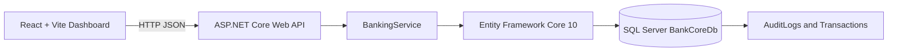

# BankCore Banking Management System

## Evidence and Implementation Report

**Project type:** Independently developed portfolio MVP  
**Project name:** BankCore Banking Management System  
**Repository:** GitHub repository URL to be added  
**Prepared for:** Software engineering portfolio demonstration  
**Status:** MVP implementation with documented limitations

> BankCore is a demonstration application. It is not production banking software and does not connect to real bank accounts, payment networks, payment cards, or real customer information.

---

## 1. Project objective

BankCore demonstrates practical full-stack software engineering skills using:

- ASP.NET Core Web API
- C# and .NET 10
- Entity Framework Core 10
- Microsoft SQL Server
- React and Vite
- REST API design
- Financial transaction processing
- SQL transactions and concurrency controls
- CI/CD concepts

The application provides a small banking-management workflow using fictional data:

1. Register customers.
2. Open bank accounts.
3. Deposit funds.
4. Withdraw funds.
5. Transfer funds between accounts.
6. Review transaction history.
7. Display live dashboard metrics.

---

## 2. Problem statement

Small banking demonstrations often need to show how customer records, accounts, balances, and transactions are connected. The project solves this demonstration problem by implementing a simple layered application in which:

- Customers own accounts.
- Accounts maintain decimal balances.
- Financial operations create transaction history.
- Transfers update two accounts atomically.
- Audit records are created for financial operations.
- The React dashboard reads metrics from the API.

The scope is intentionally limited to a local portfolio demonstration.

---

## 3. Technology stack

### Backend

- C#
- .NET 10
- ASP.NET Core Web API
- Controller-based endpoints
- Entity Framework Core 10
- SQL Server provider
- Swagger/OpenAPI
- Dependency injection
- Structured logging
- Middleware-based error handling

### Frontend

- React 19
- Vite
- JavaScript
- CSS
- Fetch-based API integration

### Database

- Microsoft SQL Server
- Database name: `BankCoreDb`
- Windows Authentication for local development
- EF Core migrations
- SQL Server constraints and indexes

### Automation

- GitHub Actions
- Backend restore/build/test/publish workflow
- Frontend install/lint/build workflow
- EF migration SQL artifact generation
- Deployment artifact packaging

---

## 4. Architecture



### Backend layers

- **Controllers:** HTTP routing and request/response handling.
- **DTOs:** API input and output contracts.
- **Services:** Customer, account, and financial business logic.
- **Data:** EF Core DbContext and Fluent API configuration.
- **Models:** Database entity classes.
- **Middleware:** Centralized exception handling.

### Frontend flow

The frontend requests customers, accounts, and transactions from the backend API. Dashboard cards and tables are calculated from API responses rather than hardcoded dashboard values.

---

## 5. Main implementation files

### Backend

- [Program.cs](../backend/BankCore.Api/Program.cs)
- [BankCore.Api.csproj](../backend/BankCore.Api/BankCore.Api.csproj)
- [BankCoreDbContext.cs](../backend/BankCore.Api/Data/BankCoreDbContext.cs)
- [BankingService.cs](../backend/BankCore.Api/Services/BankingService.cs)
- [IBankingService.cs](../backend/BankCore.Api/Services/IBankingService.cs)
- [Customer.cs](../backend/BankCore.Api/Models/Customer.cs)
- [Account.cs](../backend/BankCore.Api/Models/Account.cs)
- [Transaction.cs](../backend/BankCore.Api/Models/Transaction.cs)
- [AuditLog.cs](../backend/BankCore.Api/Models/AuditLog.cs)
- [BankingDtos.cs](../backend/BankCore.Api/DTOs/BankingDtos.cs)
- [ExceptionHandlingMiddleware.cs](../backend/BankCore.Api/Middleware/ExceptionHandlingMiddleware.cs)

### Frontend

- [App.jsx](../frontend/src/App.jsx)
- [App.css](../frontend/src/App.css)
- [index.css](../frontend/src/index.css)
- [main.jsx](../frontend/src/main.jsx)

### Database

- [01_CreateDatabase.sql](../database/01_CreateDatabase.sql)
- [05_SeedDemoData.sql](../database/05_SeedDemoData.sql)
- [InitialCreate.sql](../backend/BankCore.Api/Migrations/InitialCreate.sql)

### CI/CD

- [ci-cd.yml](../.github/workflows/ci-cd.yml)

---

## 6. Functional requirements implemented

### Customer management

Implemented:

- Customer registration
- Customer listing
- Customer search
- Customer lookup
- Customer update
- Customer activation/deactivation
- Unique NIC constraint
- Required field validation
- Email validation

### Account management

Implemented:

- Account creation
- Account listing
- Account search
- Account lookup
- Account activation/deactivation
- Customer-to-account relationship
- Unique account number constraint
- Non-negative opening balance
- Decimal account balance

### Deposit

Implemented:

- Account lookup
- Positive amount validation
- Active account validation
- Balance increase
- Deposit transaction history
- Audit log entry
- Updated balance response

### Withdrawal

Implemented:

- Account lookup
- Positive amount validation
- Active account validation
- Sufficient balance validation
- Balance decrease
- Withdrawal transaction history
- Audit log entry
- Negative balance prevention

### Fund transfer

Implemented:

- Source account validation
- Destination account validation
- Same-account rejection
- Active account validation
- Sufficient balance validation
- Source debit
- Destination credit
- Transfer-out transaction
- Transfer-in transaction
- Shared transfer reference
- Audit log entry
- Atomic database operation

### Transaction history

Implemented:

- Pagination
- Account ID filtering
- Transaction type filtering
- Newest-first ordering
- Transaction reference
- Previous balance
- New balance
- Description
- Created timestamp

---

## 7. API endpoints

### Customers

```http
GET    /api/customers
GET    /api/customers/{id}
POST   /api/customers
PUT    /api/customers/{id}
PATCH  /api/customers/{id}/status?active=true
```

### Accounts

```http
GET    /api/accounts
GET    /api/accounts/{id}
POST   /api/accounts
PATCH  /api/accounts/{id}/status?active=true
```

### Transactions

```http
GET  /api/transactions
POST /api/transactions/deposit
POST /api/transactions/withdraw
POST /api/transactions/transfer
```

Swagger is available when the API is running:

```text
https://localhost:7220/swagger
```

---

## 8. Database design

The database contains:

1. `Customers`
2. `Accounts`
3. `Transactions`
4. `AuditLogs`
5. `__EFMigrationsHistory`

### Customers

- Integer identity primary key
- Unique NIC
- Required name, email, phone, and address
- Active/inactive status
- UTC timestamp with offset

### Accounts

- Integer identity primary key
- Unique account number
- Foreign key to customer
- `DECIMAL(18,2)` balance
- Non-negative balance check constraint
- SQL Server `rowversion` concurrency column

### Transactions

- Bigint identity primary key
- Foreign key to account
- Transaction reference
- Transaction type
- `DECIMAL(18,2)` amount
- Previous and new balances
- Positive amount check constraint

### AuditLogs

- Bigint identity primary key
- Action
- Entity name and ID
- Transaction reference
- Operation details
- Created timestamp

---

## 9. Entity Framework Core implementation

The DbContext is [BankCoreDbContext.cs](../backend/BankCore.Api/Data/BankCoreDbContext.cs).

It configures:

- DbSets for all entities
- Primary keys
- Foreign keys
- Unique indexes
- Transaction indexes
- Decimal precision
- Check constraints
- Delete behavior
- SQL Server rowversion concurrency

Existing migrations:

- `20261101054334_InitialCreate`
- `20261101072942_AddTransactionAmountConstraint`

The migrations were applied to the local SQL Server database `BankCoreDb`.

---

## 10. Financial correctness

Financial amounts use `decimal`, not `float` or `double`.

Deposit, withdrawal, and transfer operations use:

- Positive amount validation
- `DECIMAL(18,2)` database columns
- SQL Server `Serializable` transactions
- Explicit rollback on failure
- SQL Server `rowversion` concurrency checks
- Deterministic account ordering for transfers
- Non-negative account database constraint
- Transaction history
- Audit logging

If an operation fails before commit, the balance change, transaction record, and audit record are rolled back together.

---

## 11. Error handling

[ExceptionHandlingMiddleware.cs](../backend/BankCore.Api/Middleware/ExceptionHandlingMiddleware.cs) handles:

- Missing records as HTTP 404
- Business conflicts as HTTP 409
- Unexpected errors as HTTP 500

Internal stack traces are not returned to API clients.

---

## 12. Security considerations

Implemented:

- EF Core parameterized database access
- Server-side model validation
- SQL constraints
- No passwords or card data
- No real banking information
- No real customer information
- Development-only CORS allow-list
- Generic unexpected-error responses
- Audit records for financial operations

Not implemented:

- Authentication
- Authorization
- JWT or ASP.NET Core Identity
- Role-based access
- Rate limiting
- Production security headers
- Production secrets management
- Full operational monitoring

These are known limitations of this portfolio MVP.

---

## 13. Frontend implementation

The React dashboard includes:

- Overview dashboard
- Customer registration and directory
- Account opening and portfolio
- Deposit form
- Withdrawal form
- Transfer form
- Transaction history table
- Loading indicator
- Error notices
- Success notices
- Responsive layout

The dashboard reads data from the API using the configured API URL:

```text
http://localhost:5095/api
```

The frontend does not use hardcoded dashboard metrics.

---

## 14. Demo data

[05_SeedDemoData.sql](../database/05_SeedDemoData.sql) contains fictional, repeatable demo data.

Verified seeded data included:

```text
Customers: 8
Accounts: 7
Transactions: 14
AuditLogs: 14
```

The records include:

- Deposits
- Withdrawals
- Transfer-out entry
- Transfer-in entry
- Audit entries

No real NIC, account, or customer data is used.

---

## 15. CI/CD implementation

[ci-cd.yml](../.github/workflows/ci-cd.yml) provides:

- .NET restore
- .NET Release build
- .NET test command
- API publish artifact
- EF migration SQL artifact
- Node.js setup
- `npm ci`
- Frontend lint
- Frontend production build
- Deployment package artifact

The workflow does not automatically connect to SQL Server or apply migrations. This avoids storing database credentials in source control and requires a protected deployment environment for real deployment.

---

## 16. Verification results

### .NET build

Command executed:

```powershell
dotnet build .\backend\BankCore.Api\BankCore.Api.csproj
```

Result:

```text
Build succeeded.
0 errors
```

Known warnings:

- NuGet vulnerability warnings involving `System.Security.Cryptography.Pkcs 9.0.11`

### Database migration

Command executed:

```powershell
dotnet ef database update `
  --project .\backend\BankCore.Api\BankCore.Api.csproj `
  --startup-project .\backend\BankCore.Api\BankCore.Api.csproj
```

Result:

- Initial migration applied
- Transaction constraint migration applied
- `Accounts` table verified
- `Customers` table verified
- `Transactions` table verified
- `AuditLogs` table verified
- `__EFMigrationsHistory` verified

### Demo data API verification

The running API returned:

```text
Customers=8
Accounts=7
Transactions=14
TransferEntries=2
```

### Frontend build

Command executed:

```powershell
npm run build
```

Result:

```text
Build succeeded
```

### Frontend dependency installation

`npm ci` was attempted. On the local Windows environment it encountered a file-lock error involving the Rolldown native binary. This was an environment-specific dependency lock and is not reported as a successful `npm ci` result.

### Automated tests

No dedicated xUnit or integration test project exists yet. Therefore, no automated test cases are claimed as passed.

---

## 17. Evidence checklist

The following evidence should be collected for a complete portfolio submission:

- [ ] GitHub repository URL
- [ ] Commit history screenshot
- [ ] Successful backend build output
- [ ] SQL Server database screenshot
- [ ] `Customers` table screenshot
- [ ] `Accounts` table screenshot
- [ ] `Transactions` table screenshot
- [ ] `AuditLogs` table screenshot
- [ ] EF migrations history screenshot
- [ ] Swagger screenshot
- [ ] React dashboard screenshot
- [ ] Customer registration screenshot
- [ ] Account opening screenshot
- [ ] Deposit screenshot
- [ ] Withdrawal screenshot
- [ ] Fund transfer screenshot
- [ ] Transaction history screenshot
- [ ] Demo data query output
- [ ] CI/CD workflow run screenshot
- [ ] Backend artifact screenshot
- [ ] Frontend artifact screenshot
- [ ] EF migration SQL artifact screenshot
- [ ] Automated test output after tests are added

Evidence must only be marked complete after the corresponding command or workflow has actually been executed.

---

## 18. Known limitations

1. Authentication and authorization are not implemented.
2. No dedicated automated unit test project exists.
3. No dedicated integration test project exists.
4. The frontend is a dashboard shell rather than a full routed banking portal.
5. Production deployment infrastructure is not configured.
6. The CI/CD workflow packages artifacts but does not deploy to a live host.
7. SQL Server credentials and deployment secrets are intentionally not stored in the repository.
8. The application is not suitable for real banking operations.

---

## 19. Future improvements

- Add ASP.NET Core Identity or validated JWT authentication.
- Add role-based authorization.
- Add xUnit service tests.
- Add API integration tests with a test database.
- Add frontend component tests.
- Add date-range transaction filters.
- Add dedicated customer and account details pages.
- Add production logging and monitoring.
- Add protected deployment environments.
- Add SQL Server backup and recovery procedures.
- Add static analysis and dependency vulnerability gates.

---

## 20. Personal contribution declaration

This project is an independently developed portfolio demonstration. The implementation, configuration, database design, API design, frontend dashboard, transaction rules, and documentation should be presented only as work that was actually completed and verified. No employment experience, production banking deployment, certification, performance claim, or test result should be inferred from this report unless separately evidenced.

